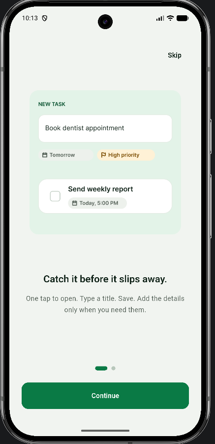
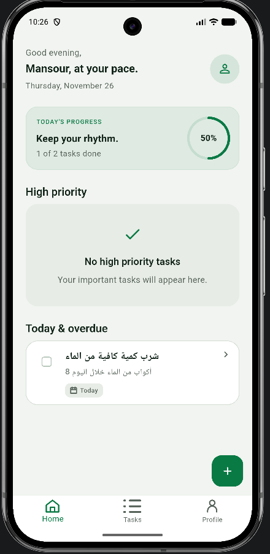
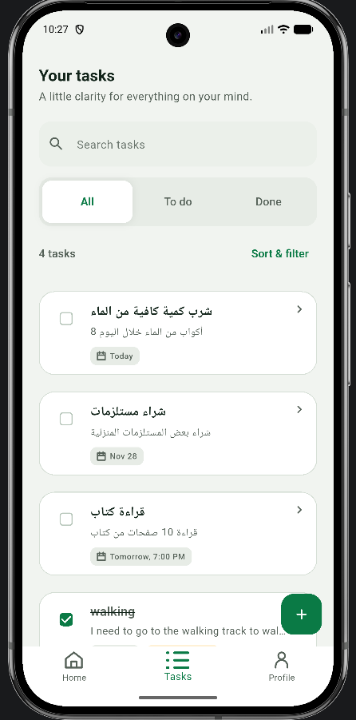
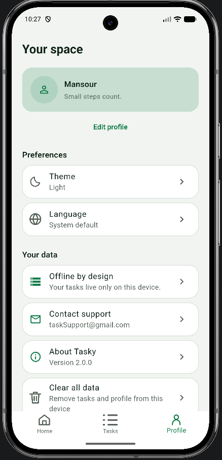

# Tasky

A simple and focused task management app built with Flutter to help users organize their daily tasks, track progress, and manage their personal productivity.

## Screenshots

| Onboarding | Home |
|:---:|:---:|
|  |  |

| Tasks | Profile |
|:---:|:---:|
|  |  |

## Features

- Onboarding experience for new users.
- Create, edit, delete, and restore tasks.
- Mark tasks as completed or pending.
- Set task priorities.
- Add due dates and specific times.
- Search, filter, and sort tasks.
- Organize tasks by due date.
- Track task progress through statistics.
- Manage personal profile and avatar.
- Customize app appearance with Light, Dark, or System themes.
- Switch between Arabic and English.
- Local data persistence.

## Tech Stack

- **Flutter** & **Dart**
- **Provider** – State management
- **Clean Architecture** – Project architecture
- **SQLite (sqflite)** – Local database
- **SharedPreferences** – Local settings and onboarding state
- **UUID** – Unique task identifiers
- **Flutter ScreenUtil** – Responsive UI
- **Flutter SVG** – SVG assets
- **Image Picker** – Profile image selection

## Architecture

Tasky follows Clean Architecture to separate responsibilities and keep the code organized, maintainable, and easier to extend.

```text
lib/
├── app/
│   └── di/
│       └── app_dependencies.dart
│
├── core/
│   ├── constants/
│   ├── enums/
│   ├── errors/
│   ├── extensions/
│   ├── services/
│   ├── theme/
│   ├── utils/
│   └── validators/
│
├── data/
│   ├── constants/
│   ├── datasources/
│   │   └── local/
│   ├── models/
│   ├── repositories/
│   └── services/
│
├── domain/
│   ├── entities/
│   ├── repositories/
│   └── usecases/
│       ├── onboarding/
│       ├── profile/
│       ├── settings/
│       └── tasks/
│
└── presentation/
    ├── app/
    ├── controllers/
    ├── formatters/
    ├── screens/
    │   ├── home/
    │   ├── main/
    │   ├── onboarding/
    │   ├── profile/
    │   ├── splash/
    │   ├── tasks/
    │   └── welcome/
    └── widgets/
```

### Layer Responsibilities

- **Core:** Shared utilities, constants, themes, enums, validation, and error handling.
- **Data:** Local data sources, models, database operations, and repository implementations.
- **Domain:** Business entities, repository contracts, and use cases.
- **Presentation:** Screens, widgets, controllers, and UI state management.
- **App:** Dependency injection and application setup.

## Data Storage

Tasky stores data locally on the device.

| Data | Storage |
|---|---|
| Tasks | SQLite |
| User Profile | SQLite |
| App Settings | SharedPreferences |
| Onboarding Status | SharedPreferences |
| Profile Avatar | Local file storage |

## Getting Started

### Prerequisites

- Flutter SDK
- Dart SDK
- Android Studio or VS Code

### Installation

1. Clone the repository:

```bash
git clone https://github.com/Mh06a/Tasky.git
```

2. Navigate to the project directory:

```bash
cd Tasky
```

3. Install dependencies:

```bash
flutter pub get
```

4. Run the application:

```bash
flutter run
```

## Project Status

Completed — Tasky is a personal project built to practice Flutter development, application architecture, state management, local storage, and UI development.

## Author

**Mansour Hussein**

- GitHub: [Mh06a](https://github.com/Mh06a)
